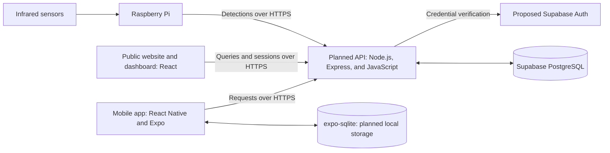
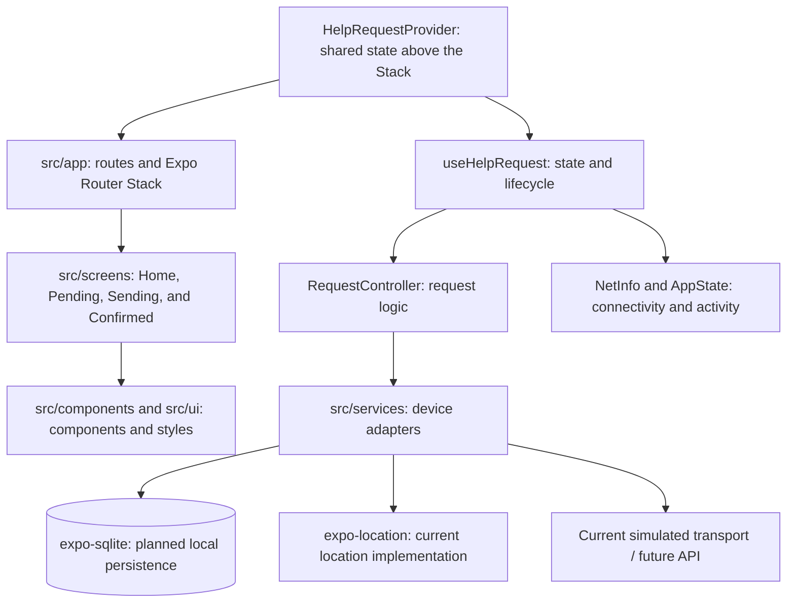
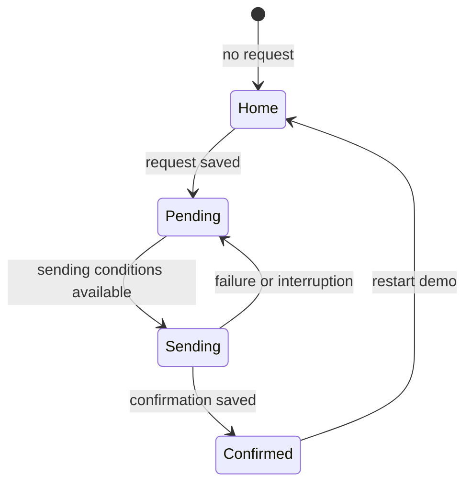
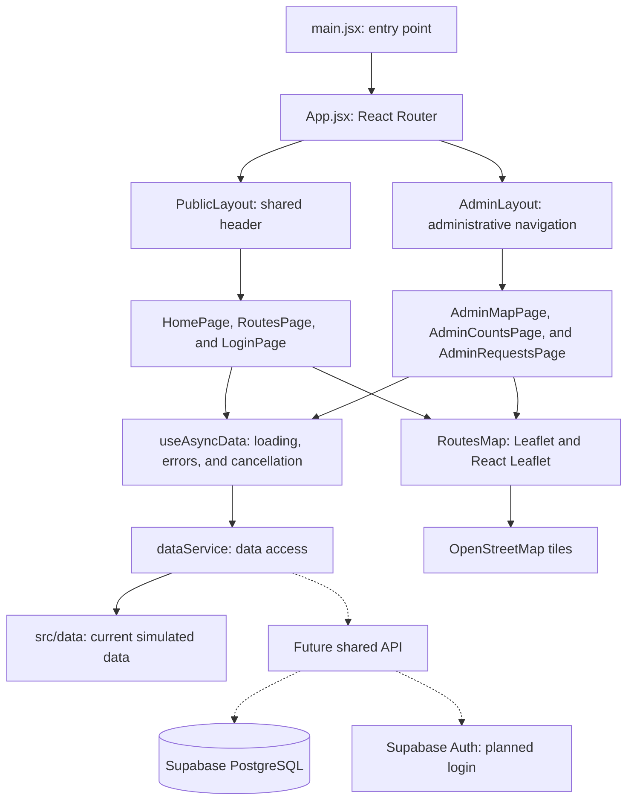
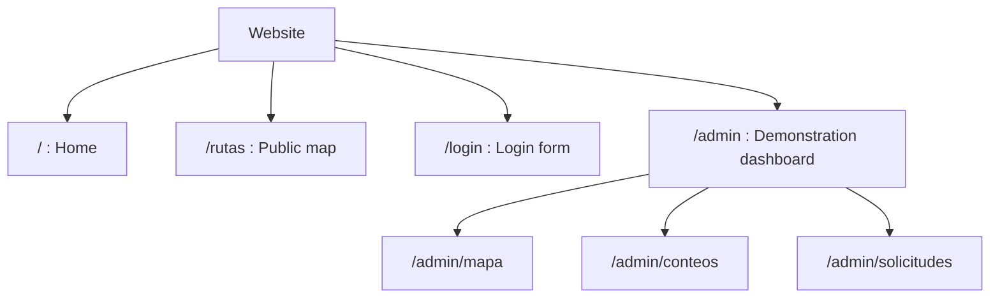
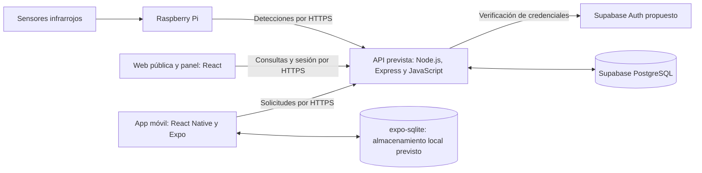
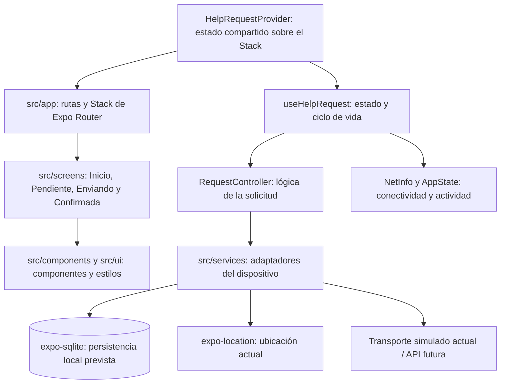
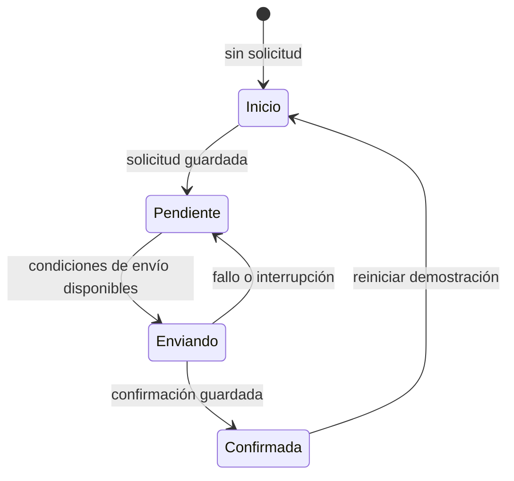
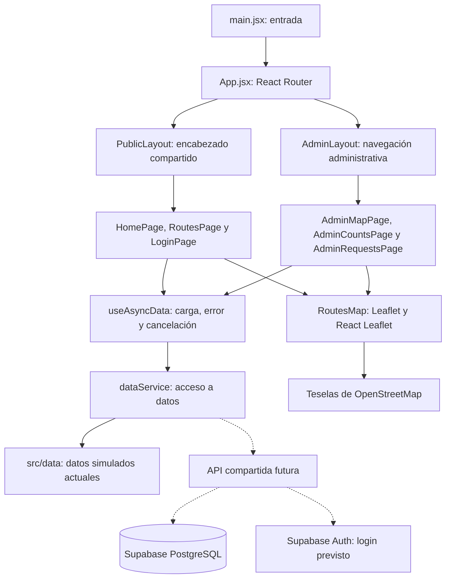
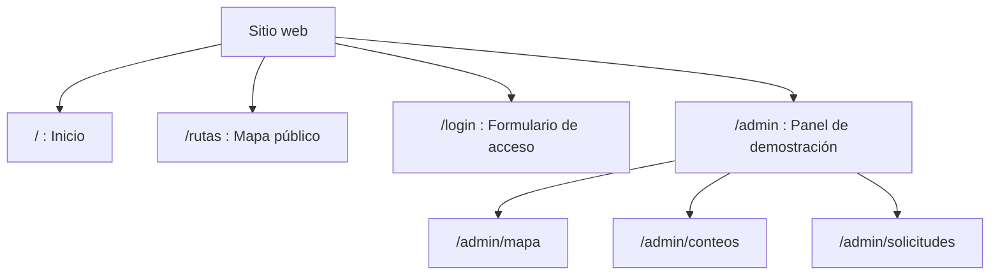

# Forest Monitoring

[English](#english) | [Español](#español)

## English

### Repository Purpose

Forest Monitoring is an academic prototype for trail monitoring and help requests.
This repository brings together a mobile app for visitors, a public website for
exploring routes, an administrative dashboard, and the planned components for
integrating sensors through a Raspberry Pi.

The app records help requests and keeps them on the phone. The website allows
users to explore routes, and the dashboard is designed to display sensors,
counts, and received requests. Both clients will share an API and a central
database. The app, website, and planned API use **JavaScript**.

### Overall Project Structure

```text
forest-monitoring/
├── mobile/       # Mobile app: React Native, Expo, and Expo Router
├── web/          # Public website and dashboard: React, Vite, and React Router
├── backend/      # Documentation and future shared API implementation
├── hardware/     # Documentation and future Raspberry Pi and sensor code
├── .gitignore    # Local and generated file exclusions
└── README.md     # System purpose, structure, and architecture
```

Each component has its own dependencies and commands. Documentation maintained
only locally is not included in this outline.

### Overall Architecture and Backend Services

The design includes a shared API for the app, website, and Raspberry Pi. Clients
will consume the API over HTTPS; the API will access central services and apply
validation, authorization, and duplicate-prevention rules.



| Planned Service | Purpose | Rationale |
| --- | --- | --- |
| Node.js with Express and JavaScript | Shared API for receiving records, providing queries, and controlling access. | Centralizes rules and contracts; keeps JavaScript as the language for clients and the API. |
| Supabase PostgreSQL | Central database for routes, points, detections, and requests. | Supports data relationships and uniqueness constraints to prevent duplicate records. |
| Supabase Auth | Administrative credential verification. | Delegates credential management; the API will continue checking permissions and managing dashboard sessions. |

**Integration status:** the app uses simulated transport and confirmation; the
website uses demonstration data and has no real administrative session. The API,
Supabase Auth, and central integration remain pending. Final mobile persistence
will use `expo-sqlite`; that integration is also pending. Confirmed receipt will
mean that the backend saved the request, without implying it has been attended to.

### 1. Mobile App

#### Purpose and Technologies

The app creates a help request, saves it locally, and displays its states: Home,
Pending, Sending, and Confirmed. It is developed with **React Native, Expo, and
JavaScript**, using **Expo Router and Stack** navigation. It uses NetInfo to observe
connectivity and currently includes location through `expo-location`.
Planned storage with `expo-sqlite` will preserve the identifier and original
timestamp when retrying transmission.

#### Structure

```text
mobile/
├── src/
│   ├── app/          # Routes and Expo Router Stack configuration
│   ├── screens/      # Home, Pending, Sending, and Confirmed screens
│   ├── components/   # Reusable visual elements and route control
│   ├── context/      # Shared request state
│   ├── hooks/        # Connection between logic, React, and lifecycle
│   ├── core/         # Request controller and rules
│   ├── navigation/   # Route selection based on state
│   ├── services/     # Storage, location, and data transport
│   └── ui/           # Shared theme and styles
├── assets/           # App icons and images
├── tests/            # Automated logic and navigation tests
├── app.json          # Expo configuration
├── package.json      # Project dependencies and commands
├── package-lock.json # Resolved dependency versions
├── eslint.config.js  # Code checking configuration
├── .nvmrc            # Node.js major version used
├── .gitignore        # Local and generated files excluded from Git
└── README.md         # Purpose, structure, architecture, and navigation
```

#### Component Diagram



Routes determine which screen to display. Screens consume state and actions from
the shared provider. The controller contains the request lifecycle rules, and
services perform device operations.

#### Architecture Decisions

| Decision | Why This Structure or Service Was Chosen |
| --- | --- |
| React Native with Expo for the mobile app | Allows maintaining an app with shared components for Android and iOS within the Expo environment already used by the team. |
| Separate routes, screens, components, logic, and services | Gives each responsibility a clear location. Allows changing a screen without modifying storage and testing request logic without a phone. |
| Share state through HelpRequestProvider | Maintains a single controller instance for all screens. A transition does not restart data restoration or create another request. |
| Save locally before transmitting | Keeps a pending request even without a connection and restores it when the app is reopened. We will use expo-sqlite to store requests in a local database. |
| Encapsulate sending in a service | Allows replacing simulated transport with API requests without adding network logic to each screen. |
| Use a shared API for mobile, web, and Raspberry Pi | Centralizes validation, permissions, and persistence rules so all clients use the same contract. Express and JavaScript are the proposed implementation. |
| Use Supabase PostgreSQL as the central database | The relational model associates routes, sensors, and detections, and supports constraints to prevent duplicate IDs. The managed service reduces initial infrastructure setup. |
| Use Supabase Auth for administrative credentials | Delegates credential verification to a specialized service. The API will remain responsible for checking which operations an administrator can perform. |

Final local persistence will use `expo-sqlite` to preserve pending requests, their
identifiers, and original timestamps even when the app closes. Its integration is
pending, as are the API and central services. The diagrams include this planned
architecture decision.

#### Navigation: Expo Router with Stack

**We chose Expo navigation using Expo Router and a Stack navigator.** The interface
is built with React Native; Expo Router is the specific library that manages
navigation between screens through route files.

Stack configuration is in `mobile/src/app/_layout.js` and uses these routes:

| Route | File | Screen |
| --- | --- | --- |
| `/` | `mobile/src/app/index.js` | Home and help button. |
| `/pendiente` | `mobile/src/app/pendiente.js` | Saved request and retry option. |
| `/enviando` | `mobile/src/app/enviando.js` | Request being sent. |
| `/confirmada` | `mobile/src/app/confirmada.js` | Confirmation, currently simulated. |



##### Why We Chose This Navigation

- **Matches the app workflow:** Home, Pending, Sending, and Confirmed are stages
  of one request, so a Stack organizes them without adding tabs or a drawer for
  independent features.
- **Fits the Expo structure:** each screen has a route in `mobile/src/app/`, and
  navigation configuration is centralized in `_layout.js`.
- **Preserves shared state:** `HelpRequestProvider` wraps the Stack and keeps the
  same request available during screen transitions.
- **Displays the correct stage:** `getRequestRoute` and `HelpRoute` use request
  state to redirect to the appropriate screen, including after restoring a saved
  request.

#### Local Development

From the repository root:

```sh
cd mobile
npm ci
npm start
```

Scan the QR code using Expo Go compatible with the project's Expo version. To
check the code and run available tests:

```sh
npm run lint
npm test
```

More information is available in the [mobile app README](mobile/README.md).

### 2. Website and Administrative Dashboard

#### Purpose and Technologies

The public website allows exploring preloaded routes without signing in. The
administrative dashboard is designed to display sensor points, counts by route,
and help requests. It currently uses fictional data; the login form and
administrative routes are a demonstration without real authentication.

The website is developed with **React and JavaScript**, using **Vite** for
development and builds, **React Router** for routing, and **Leaflet with React
Leaflet** for maps. Styles are organized in CSS files.

#### Structure

```text
web/
├── src/
│   ├── pages/        # Home, routes, login, and administrative pages
│   ├── components/   # Navigation, layouts, maps, and data states
│   ├── hooks/        # useAsyncData: loading, errors, and cancellation
│   ├── services/     # dataService: data access and future HTTP integration
│   ├── data/         # Fictional demo routes, sensors, and records
│   ├── assets/       # Images used by the interface
│   ├── App.jsx       # Route and layout definitions
│   └── main.jsx      # Entry point and React mounting
├── public/           # Public static assets
├── tests/            # Automated data service tests
├── index.html        # HTML entry document
├── vite.config.js    # Vite configuration
├── eslint.config.js  # Code checking configuration
├── .env.example      # Demo scenario configuration example
├── package.json      # Dependencies and commands
├── package-lock.json # Resolved dependency versions
└── README.md         # Website-specific instructions
```

#### Component Diagram



Pages present information and use `useAsyncData` to load it. The
`dataService.js` service encapsulates the data source; its simulated adapters will
be replaced with HTTP calls. Errors, empty responses, and loading states are
presented separately. A failed query is not converted into zero detections or an
empty list.

#### Architecture Decisions

| Decision | Why We Chose It |
| --- | --- |
| React with JavaScript | Allows building screens with reusable components while maintaining the language agreed upon by the team. |
| Vite | Provides a development server and build process for the website. |
| Separate pages, components, hooks, and services | Separates presentation, loading, and data access, facilitating maintenance and isolated tests. |
| Share public and administrative layouts | Reuses headers and navigation without repeating them on each screen. Does not replace the authorization controls the API must apply. |
| React Router | Identifies each view by its URL, supports nested routes, and shares layouts between related screens. |
| Leaflet and React Leaflet | Integrate interactive maps, routes, and markers into React components. |
| Replaceable data service | Allows development with controlled scenarios and backend integration without changing the data source in each page. |
| Separate public and administrative information | Public routes will display only route information; sensors, counts, and requests will require authorization when integrating the API. |

#### Navigation: React Router

Website navigation is defined in `web/src/App.jsx`. It uses URLs to distinguish
pages and nested routes to share the dashboard layout.

| URL | View |
| --- | --- |
| `/` | Public home page. |
| `/rutas` | Map and route exploration. |
| `/login` | Login form, currently a demonstration. |
| `/admin` | Redirect to `/admin/mapa`. |
| `/admin/mapa` | Demonstration sensor map. |
| `/admin/conteos` | Demonstration counts by route. |
| `/admin/solicitudes` | Demonstration received requests. |



We chose React Router because the website has independent views accessed through
URLs and shared navigation. On mobile, Expo Router with Stack organizes the stages
of a request. When connecting the backend, both administrative queries and the
session must be protected on the server.

#### Local Development and Tests

From the repository root:

```sh
cd web
npm ci
npm run dev
```

To check the code, run tests, and generate a build:

```sh
npm run lint
npm test
npm run build
```

The service can simulate `success`, `empty`, or `error` using
`VITE_DEMO_SCENARIO`. Configuration is documented in the
[website README](web/README.md). Maps require internet access to load OpenStreetMap
tiles; current routes are fictional rather than verified trails.

### Collaboration

1. Keep `main` working and update it before starting a task.
2. Create a branch for each change, such as `feature/web-map` or `feature/app-help-button`.
3. Make small commits with clear messages and push the branch.
4. Open a pull request and request a review before merging.
5. Update documentation when routes, services, or contracts change.

Do not commit credentials or local configuration files. Share configuration
examples through `.env.example` without secret values.

### References

- [Expo Router](https://docs.expo.dev/router/introduction/).
- [Stack in Expo Router](https://docs.expo.dev/router/advanced/stack/).
- [Vite](https://vite.dev/guide/).
- [React Router](https://reactrouter.com/start/declarative/routing).
- [React Leaflet](https://react-leaflet.js.org/docs/start-introduction/).
- [Supabase PostgreSQL](https://supabase.com/docs/guides/database/overview).
- [Supabase Auth](https://supabase.com/docs/guides/auth).

---

## Español

### Propósito del repositorio

Forest Monitoring es un prototipo académico de monitoreo de senderos y solicitud
de ayuda. Este repositorio reúne una app móvil para visitantes, una página web
pública para explorar rutas, un panel administrativo y los componentes previstos
para integrar sensores mediante una Raspberry Pi.

La app permite registrar solicitudes de ayuda y conservarlas en el teléfono.
La web permite explorar rutas y el panel está diseñado para consultar sensores,
conteos y solicitudes recibidas. Ambos clientes compartirán una API y una base
central. El código de la app, la web y la API prevista utiliza **JavaScript**.

### Estructura general del proyecto

```text
forest-monitoring/
├── mobile/       # App móvil: React Native, Expo y Expo Router
├── web/          # Web pública y panel: React, Vite y React Router
├── backend/      # Documentación y futura implementación de la API compartida
├── hardware/     # Documentación y futuro código de Raspberry Pi y sensores
├── .gitignore    # Exclusiones de archivos locales y generados
└── README.md     # Propósito, estructura y arquitectura del sistema
```

Cada componente tiene sus propias dependencias y comandos. La documentación
mantenida sólo de forma local no se incluye en este esquema.

### Arquitectura general y servicios de backend

El diseño contempla una API común para la app, la web y la Raspberry Pi. Los
clientes consumirán la API mediante HTTPS; la API accederá a los servicios
centrales y aplicará validación, autorización y reglas para evitar duplicados.



| Servicio previsto                | Propósito                                                                       | Justificación                                                                                                 |
| -------------------------------- | ------------------------------------------------------------------------------- | ------------------------------------------------------------------------------------------------------------- |
| Node.js con Express y JavaScript | API compartida para recibir registros, ofrecer consultas y controlar el acceso. | Centraliza reglas y contratos; mantiene JavaScript como lenguaje de los clientes y la API.                    |
| Supabase PostgreSQL              | Base central de rutas, puntos, detecciones y solicitudes.                       | Permite relaciones entre datos y restricciones de unicidad para evitar registros duplicados.                  |
| Supabase Auth                    | Verificación de credenciales administrativas.                                   | Delega el manejo de credenciales; la API seguirá comprobando permisos y administrando las sesiones del panel. |

**Estado de integración:** la app utiliza transporte y confirmación simulados; la
web usa datos de demostración y no tiene una sesión administrativa real. La API,
Supabase Auth y la integración central siguen pendientes. La persistencia móvil
definitiva se implementará con `expo-sqlite`; esa integración también está pendiente.
Una recepción confirmada significará que el backend guardó la solicitud, sin
implicar que ya fue atendida.

### 1. Aplicación móvil

#### Propósito y tecnologías

La app permite crear una solicitud de ayuda, guardarla localmente y consultar sus
estados: Inicio, Pendiente, Enviando y Confirmada. Se desarrolla con **React Native,
Expo y JavaScript**, con navegación **Expo Router y Stack**. Usa NetInfo para
observar conectividad y actualmente incluye ubicación con `expo-location`.
El almacenamiento previsto con `expo-sqlite` permitirá conservar el identificador
y la fecha original al reintentar el envío.

#### Estructura

```text
mobile/
├── src/
│   ├── app/          # Rutas y configuración del Stack de Expo Router
│   ├── screens/      # Pantallas Inicio, Pendiente, Enviando y Confirmada
│   ├── components/   # Elementos visuales reutilizables y control de rutas
│   ├── context/      # Estado compartido de la solicitud
│   ├── hooks/        # Conexión entre la lógica, React y el ciclo de vida
│   ├── core/         # Controlador y reglas de la solicitud
│   ├── navigation/   # Selección de la ruta según el estado
│   ├── services/     # Almacenamiento, ubicación y transporte de datos
│   └── ui/           # Tema y estilos compartidos
├── assets/           # Iconos e imágenes de la aplicación
├── tests/            # Pruebas automatizadas de lógica y navegación
├── app.json          # Configuración de Expo
├── package.json      # Dependencias y comandos del proyecto
├── package-lock.json # Versiones resueltas de las dependencias
├── eslint.config.js  # Configuración de revisión de código
├── .nvmrc            # Versión principal de Node.js utilizada
├── .gitignore        # Archivos locales y generados excluidos de Git
└── README.md         # Propósito, estructura, arquitectura y navegación
```

#### Diagrama de componentes



Las rutas determinan qué pantalla mostrar. Las pantallas consumen el estado y las
acciones del proveedor compartido. El controlador contiene las reglas del ciclo
de la solicitud y los servicios realizan las operaciones del dispositivo.

#### Decisiones de arquitectura

| Decisión                                                   | Por qué se eligió esta estructura o servicio                                                                                                                                                            |
| ---------------------------------------------------------- | ------------------------------------------------------------------------------------------------------------------------------------------------------------------------------------------------------- |
| React Native con Expo para la app móvil                    | Permite mantener una aplicación con componentes compartidos para Android e iOS y trabajar dentro del entorno Expo que ya utiliza el equipo.                                                             |
| Separar rutas, pantallas, componentes, lógica y servicios  | Mantiene cada responsabilidad en una ubicación clara. Permite cambiar una pantalla sin modificar el almacenamiento y probar la lógica de solicitudes sin depender de un teléfono.                       |
| Compartir el estado mediante HelpRequestProvider           | Mantiene una sola instancia del controlador para todas las pantallas. Una transición no reinicia la recuperación de datos ni crea otra solicitud.                                                       |
| Guardar localmente antes de transmitir                     | Permite conservar una solicitud pendiente aunque no exista conexión y recuperarla al abrir nuevamente la app. Usaremos expo-sqlite para guardar las solicitudes en una base de datos local.             |
| Encapsular el envío en un servicio                         | Permite sustituir el transporte simulado por peticiones a la API sin incorporar la lógica de red en cada pantalla.                                                                                      |
| Utilizar una API compartida para móvil, web y Raspberry Pi | Centraliza validaciones, permisos y reglas de guardado para que todos los clientes utilicen el mismo contrato. Express y JavaScript son la implementación propuesta.                                    |
| Utilizar Supabase PostgreSQL como base central             | El modelo relacional permite asociar rutas, sensores y detecciones, y establecer restricciones para evitar IDs duplicados. El servicio administrado reduce la configuración inicial de infraestructura. |
| Utilizar Supabase Auth para credenciales administrativas   | Permite delegar la verificación de credenciales en un servicio especializado. La API seguirá siendo responsable de comprobar qué operaciones puede realizar un administrador.                           |

La persistencia local definitiva se implementará con `expo-sqlite` para conservar
las solicitudes pendientes, sus identificadores y sus fechas originales aunque
se cierre la app. Su integración está pendiente, al igual que la API y los
servicios centrales. Los diagramas incluyen esta decisión de arquitectura prevista.

#### Navegación: Expo Router con Stack

**Se eligió la navegación de Expo mediante Expo Router y un navegador Stack.** La
interfaz está construida con React Native; Expo Router es la biblioteca concreta
que administra la navegación entre sus pantallas mediante archivos de ruta.

La configuración del Stack está en `mobile/src/app/_layout.js` y utiliza las siguientes
rutas:

| Ruta          | Archivo                        | Pantalla                                  |
| ------------- | ------------------------------ | ----------------------------------------- |
| `/`           | `mobile/src/app/index.js`      | Inicio y botón de ayuda.                  |
| `/pendiente`  | `mobile/src/app/pendiente.js`  | Solicitud guardada y opción de reintento. |
| `/enviando`   | `mobile/src/app/enviando.js`   | Solicitud en proceso de envío.            |
| `/confirmada` | `mobile/src/app/confirmada.js` | Confirmación, actualmente simulada.       |



##### Por qué elegimos esta navegación

- **Corresponde al flujo de la app:** Inicio, Pendiente, Enviando y Confirmada son
  etapas de una misma solicitud, por lo que un Stack permite organizarlas sin
  agregar pestañas o un menú lateral para funciones independientes.
- **Se integra con la estructura de Expo:** cada pantalla tiene una ruta en
  `mobile/src/app/` y la configuración de navegación se concentra en `_layout.js`.
- **Conserva el estado compartido:** `HelpRequestProvider` envuelve el Stack y
  mantiene disponible la misma solicitud durante los cambios de pantalla.
- **Muestra la etapa correcta:** `getRequestRoute` y `HelpRoute` utilizan el estado
  de la solicitud para redirigir a la pantalla correspondiente, incluso después
  de recuperar una solicitud guardada.

#### Ejecución local

Desde la raíz del repositorio:

```sh
cd mobile
npm ci
npm start
```

Escanea el QR con Expo Go compatible con la versión de Expo del proyecto. Para
revisar el código y ejecutar las pruebas disponibles:

```sh
npm run lint
npm test
```

Más información en el [README de la app móvil](mobile/README.md).

### 2. Página web y panel administrativo

#### Propósito y tecnologías

La web pública permite explorar rutas precargadas sin iniciar sesión. El panel
administrativo está diseñado para consultar puntos de sensores, conteos por ruta
y solicitudes de ayuda. Actualmente utiliza datos ficticios; el formulario de
login y las rutas administrativas son una demostración sin autenticación real.

La web está desarrollada con **React y JavaScript**, utiliza **Vite** para desarrollo
y compilación, **React Router** para las rutas y **Leaflet con React Leaflet** para
los mapas. Los estilos se organizan en archivos CSS.

#### Estructura

```text
web/
├── src/
│   ├── pages/        # Inicio, rutas, login y páginas administrativas
│   ├── components/   # Navegación, layouts, mapas y estados de datos
│   ├── hooks/        # useAsyncData: carga, errores y cancelación
│   ├── services/     # dataService: acceso a datos y futura integración HTTP
│   ├── data/         # Rutas, sensores y registros ficticios de demostración
│   ├── assets/       # Imágenes utilizadas por la interfaz
│   ├── App.jsx       # Definición de rutas y layouts
│   └── main.jsx      # Punto de entrada y montaje de React
├── public/           # Recursos estáticos públicos
├── tests/            # Pruebas automatizadas del servicio de datos
├── index.html        # Documento HTML de entrada
├── vite.config.js    # Configuración de Vite
├── eslint.config.js  # Configuración de revisión de código
├── .env.example      # Ejemplo de configuración de escenarios de demostración
├── package.json      # Dependencias y comandos
├── package-lock.json # Versiones resueltas de dependencias
└── README.md         # Instrucciones específicas de la web
```

#### Diagrama de componentes



Las páginas presentan información y usan `useAsyncData` para cargarla. El servicio
`dataService.js` encapsula el origen de los datos; sus adaptadores simulados se
sustituirán por llamadas HTTP. Los errores, las respuestas vacías y los estados de
carga se presentan por separado. Una consulta fallida no se convierte en cero
detecciones ni en una lista vacía.

#### Decisiones de arquitectura

| Decisión                                     | Por qué la elegimos                                                                                                                                |
| -------------------------------------------- | -------------------------------------------------------------------------------------------------------------------------------------------------- |
| React con JavaScript                         | Permite construir pantallas mediante componentes reutilizables y mantener el lenguaje acordado por el equipo.                                      |
| Vite                                         | Proporciona un servidor de desarrollo y un proceso de compilación para la web.                                                                     |
| Separar pages, components, hooks y services  | Separa presentación, carga y acceso a datos, facilitando mantenimiento y pruebas aisladas.                                                         |
| Compartir layouts públicos y administrativos | Permite reutilizar encabezados y navegación sin repetirlos en cada pantalla. No sustituye los controles de autorización que deberá aplicar la API. |
| React Router                                 | Permite identificar cada vista por su URL, usar rutas anidadas y compartir layouts entre pantallas relacionadas.                                   |
| Leaflet y React Leaflet                      | Permiten integrar mapas interactivos, recorridos y marcadores dentro de los componentes de React.                                                  |
| Servicio de datos reemplazable               | Permite desarrollar con escenarios controlados y conectar el backend sin cambiar el origen de datos en cada página.                                |
| Separar información pública y administrativa | Las rutas públicas mostrarán sólo información de rutas; sensores, conteos y solicitudes requerirán autorización al integrar la API.                |

#### Navegación: React Router

La navegación web se define en `web/src/App.jsx`. Utiliza URLs para distinguir las
páginas y rutas anidadas para compartir el layout del panel.

| URL                  | Vista                                              |
| -------------------- | -------------------------------------------------- |
| `/`                  | Inicio público.                                    |
| `/rutas`             | Mapa y exploración de rutas.                       |
| `/login`             | Formulario de acceso, actualmente de demostración. |
| `/admin`             | Redirección a `/admin/mapa`.                       |
| `/admin/mapa`        | Mapa de sensores de demostración.                  |
| `/admin/conteos`     | Conteos por ruta de demostración.                  |
| `/admin/solicitudes` | Solicitudes recibidas de demostración.             |



Elegimos React Router porque la web tiene vistas independientes a las que se
accede mediante URLs y una navegación común. En el móvil, Expo Router con Stack
organiza las etapas de una solicitud. Al conectar el backend, tanto las consultas
administrativas como la sesión deberán protegerse en el servidor.

#### Ejecución local y pruebas

Desde la raíz del repositorio:

```sh
cd web
npm ci
npm run dev
```

Para revisar el código, ejecutar las pruebas y generar la compilación:

```sh
npm run lint
npm test
npm run build
```

El servicio permite simular `success`, `empty` o `error` mediante
`VITE_DEMO_SCENARIO`. La configuración se documenta en el
[README de la web](web/README.md). Los mapas requieren internet para cargar las
teselas de OpenStreetMap; las rutas actuales son ficticias y no senderos verificados.

### Colaboración

1. Mantener `main` funcionando y actualizarla antes de iniciar una tarea.
2. Crear una rama por cambio, por ejemplo `feature/web-map` o `feature/app-help-button`.
3. Realizar commits pequeños con mensajes claros y subir la rama.
4. Abrir un pull request y solicitar revisión antes de fusionarlo.
5. Actualizar la documentación cuando cambien rutas, servicios o contratos.

No subir credenciales ni archivos de configuración local. Compartir ejemplos de
configuración mediante `.env.example` sin valores secretos.

### Referencias

- [Expo Router](https://docs.expo.dev/router/introduction/).
- [Stack en Expo Router](https://docs.expo.dev/router/advanced/stack/).
- [Vite](https://vite.dev/guide/).
- [React Router](https://reactrouter.com/start/declarative/routing).
- [React Leaflet](https://react-leaflet.js.org/docs/start-introduction/).
- [Supabase PostgreSQL](https://supabase.com/docs/guides/database/overview).
- [Supabase Auth](https://supabase.com/docs/guides/auth).
